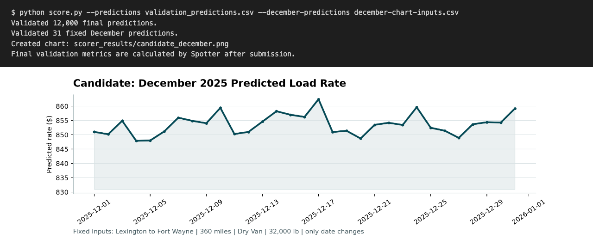

# Freight Rate Prediction Challenge

Predicts freight load rates (LightGBM + XGBoost ensemble) for the Freight Rate ML assessment, and validates the submission files with the provided scorer.



*Real output of `python score.py --predictions validation_predictions.csv --december-predictions december-chart-inputs.csv` and the chart it generates.*

The assessment brief (`Freight_Rate_ML_Assessment.pdf`) is not included in this repository.

## Layout

- `train-test.csv`, `validation.csv`, `validation-predictions-template.csv`, `december-chart-inputs.csv`: challenge data (repo root).
- `freight/`: `train.py` (Optuna tuning + final fit), `predict.py` (writes predictions and runs the scorer), `features.py`, `config.py`, and the pickled models/statistics.
- `score.py`: scorer that validates both prediction files and writes `scorer_results/candidate_december.png`.
- `validation_predictions.csv`: submitted validation predictions.

## Setup

```bash
python -m venv .venv && source .venv/bin/activate
python -m pip install -r freight/requirements.txt
```

## Usage

Predict with the committed models (overwrites `validation_predictions.csv` and `december-chart-inputs.csv`, then runs the scorer):

```bash
python freight/predict.py
```

Retrain from scratch (runs an Optuna search; can take a while):

```bash
python freight/train.py
```

Validate the submission files only:

```bash
python score.py --predictions validation_predictions.csv --december-predictions december-chart-inputs.csv
```

> **Warning:** the `.pkl` files in `freight/` are Python pickles. Unpickling can execute arbitrary code, so never load a `.pkl` from an untrusted source or one you did not verify came from this repository. If you modify or replace a model, regenerate it yourself with `python freight/train.py` rather than accepting a pickle from elsewhere. Checking the file hashes against the committed ones (`git diff --stat`) is a quick integrity test.

## License

MIT, see [LICENSE](LICENSE).
